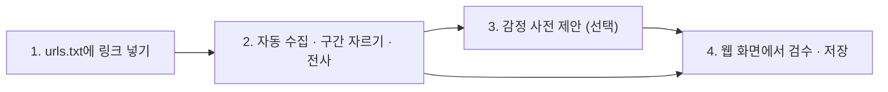

# EmoLabel 팀원용 사용 가이드

## 1. 어떤 프로그램인가요?

텍스트 파일에 **YouTube Shorts URL을 여러 개 넣어두면**, 프로그램이 알아서 영상을 받고 발화 구간을 잘라 전사해 둔 뒤, **웹 화면에서 사람이 듣고 감정(`neutral`, `angry`, `sad`, `happy`)을 확정 저장**하는 도구입니다.



- **자동으로 해주는 것**: 영상 다운로드, 180초 초과/중복 자동 필터링, 발화 구간 최대 3개 자동 선정, 한국어 대사 전사, (선택) 대사+음성 감정 모델 50:50 평균 점수표 생성
- **사람이 하는 것**: 웹에서 파형과 음성을 들으며 경계·대사·감정 확인 후 **채택 / 수정 후 채택 / 보류 / 제외** 결정 (모델은 참고용이며 자동 확정하지 않음)
- **빠진 구간 직접 추가**: 자동 선정에서 빠진 좋은 발화는 웹에서 **`＋ 새 구간 추가`**로 직접 잘라서 후보로 넣을 수 있음

---

## 2. 프로그램 구성 (핵심만)

실제 코드는 전부 `emolabel-youtube/` 폴더 안에 있습니다.

| 폴더 | 역할 |
| --- | --- |
| `emolabel-youtube/tools/` | 터미널에서 실행하는 자동화 도구 (URL 배치 수집, 감정 모델 추론, 설정 생성) |
| `emolabel-youtube/app/` | 다운로드·전사·구간 선정·검수 저장을 처리하는 백엔드(FastAPI) |
| `emolabel-youtube/static/` | 브라우저(`http://127.0.0.1:8000`)로 여는 검수 웹 화면 |
| `emolabel-youtube/data/` | 다운로드 영상, 중간 작업 파일(`workspace/`), 최종 확정 데이터셋(`output/`) — Git 제외 |

---

## 3. 처음 설치하기 (1회만)

기준 환경: **WSL2 Ubuntu (Python 3.12, CPU)** 또는 **Apple Silicon Mac**

### 3-1. 기본 설치 (필수)

```bash
# Ubuntu 기준 시스템 도구 설치 (Mac은 brew install ffmpeg uv)
sudo apt update && sudo apt install -y ffmpeg git unzip

# 저장소 이동 및 파이썬 환경 설치
cd emolabel-youtube
uv sync --locked --python 3.12

# 기본 전사(Whisper) 모델 미리 받기 (첫 1회만 다운로드)
uv run python -m app.asr
```

> **어느 모델은 자동으로 받아지나요?**
> - **한국어 전사(Whisper)**와 **발화 검출(Silero VAD)**은 위 설치만으로 자동 다운로드됩니다.
> - 즉, **감정 사전 제안 없이** 수집·후보 선정·웹 검수·수동 구간 추가만 쓰려면 여기서 바로 **4번 사용 방법**으로 넘어가면 됩니다.

### 3-2. 감정 사전 제안 모델 2개 설치 (선택)

감정 점수 비교표(`HowRU-KoELECTRA` 대사 50% + `emotion2vec+ base` 음성 50%)까지 함께 쓰려면 두 모델을 로컬에 받아 연결해야 합니다. (용량 문제로 GitHub에 없고, 의존성 충돌을 막기 위해 별도 가상환경에 깝니다.)

```bash
# 1) 감정 모델 전용 가상환경 생성 (emolabel-youtube 바깥 폴더 권장)
uv venv ~/emotion-env --python 3.12
uv pip install --python ~/emotion-env/bin/python \
  torch torchaudio transformers safetensors soundfile funasr setuptools huggingface_hub

# 2) Hugging Face에서 두 모델 로컬 다운로드 (다운로드 후 커밋 SHA 40자리 확인)
~/emotion-env/bin/python -c "
from huggingface_hub import snapshot_download
for repo, dest in [
    ('LimYeri/HowRU-KoELECTRA-Emotion-Classifier', '~/models/howru'),
    ('emotion2vec/emotion2vec_plus_base', '~/models/emotion2vec-plus-base'),
]:
    import os
    path = snapshot_download(repo_id=repo, local_dir=os.path.expanduser(dest))
    print(repo, '->', path)
"

# 3) 설정 파일 자동 생성 (아래 <TEXT_SHA>, <AUDIO_SHA>에 각 모델 커밋 SHA 40자리 입력)
cd emolabel-youtube
uv run python -m tools.configure_emotion \
  --python ~/emotion-env/bin/python \
  --text-model ~/models/howru --text-revision '<TEXT_SHA>' \
  --audio-model ~/models/emotion2vec-plus-base --audio-revision '<AUDIO_SHA>' \
  --output data/local-emotion.env
```

> 자세한 모델 설치·연결 확인(`check_emotion_connection`)은 [emolabel-youtube/README.md](../emolabel-youtube/README.md)에 있습니다.

---

## 4. 사용 방법 (4단계)

### Step 1. URL 목록 파일 만들기
`emolabel-youtube/data/urls.txt` 파일을 만들고 처리할 YouTube 링크를 한 줄에 하나씩 넣습니다. (`#` 주석·빈 줄은 무시되고 중복 링크는 자동 제거됩니다.)

```text
# 처리할 한국어 Shorts 목록
https://www.youtube.com/shorts/DGwuCn-EDfQ
https://www.youtube.com/shorts/mKwJDo0YTkM
https://www.youtube.com/shorts/6yrnO_6Hl0I
```

### Step 2. 자동 수집 · 후보 추출 실행
```bash
cd emolabel-youtube
uv run python -m tools.run_batch --urls data/urls.txt --video-workers 1
```
- 영상 다운로드 → 발화 검출 → 전사 → 영상당 최대 3개 후보 클립 추출까지 자동으로 끝납니다.
- 같은 파일로 다시 실행해도 이미 끝난 영상은 캐시를 재사용합니다.

### Step 3. 감정 사전 제안 실행 (3-2를 설치한 경우만)
```bash
# 감정 모델 설정 불러오기
set -a && source data/local-emotion.env && set +a

# 후보 목록 고정 후 감정 모델 추론 실행
uv run python -m tools.run_batch --export-candidates data/workspace/pilot-v3.json
uv run python -m tools.run_batch --candidates data/workspace/pilot-v3.json --run-tag howru-emotion2vec-mean-v1
```

### Step 4. 웹 화면에서 검수 및 저장
```bash
uv run uvicorn app.main:app --host 127.0.0.1 --port 8000
```

1. 브라우저에서 `http://127.0.0.1:8000` 접속
2. 상단에 **검수자 ID** 입력 → **`세션 시작`** → **`배치 후보 검수`** 클릭
3. 왼쪽 목록에서 후보를 하나씩 확인:
   - **재생**: `Space`(재생/일시정지), `L`(구간 반복), `[` `]`(시작/끝 지정), `1–4`(감정 선택)
   - **감정 판단**: 참고 점수표를 보고 직접 주 감정·대사·품질(`CONF`, `QUALITY`, `AMBIG`) 입력 후 **`저장 후 다음 →`**
   - **독립 정답 작성**: 모델 제안과 기존 이력을 가리고 싶으면 세션 시작 전 **`독립 정답 작성`** 체크
4. **자동 후보에 없는 구간을 직접 넣고 싶을 때**:
   - 파형 오른쪽 위 **`＋ 새 구간 추가`** 클릭 → 파형 드래그로 원하는 구간 선택 → **`검수 후보로 추가`**
   - 기존 전사가 있으면 초안이 자동으로 채워지고, 필요하면 **`대사 자동 전사`** 버튼으로 해당 구간만 다시 전사할 수 있습니다.
   - 자동 후보가 0개인 영상도 상단 URL 입력창에서 **`수동 불러오기`** 후 **`＋ 새 구간 추가`**로 넣을 수 있습니다.

---

## 5. 결과 파일은 어디에 저장되나요?

사람이 **채택**한 클립만 `emolabel-youtube/data/output/{clip_id}/` 폴더에 최종 저장됩니다.

```text
emolabel-youtube/data/output/{clip_id}/
├── clip.mp4           # 잘라낸 영상 클립
├── audio_16k.wav      # 16 kHz 모노 음성
├── prelabels.json     # 자동 전사 등 기계 초안
└── annotation.json    # 사람이 확정한 대사·감정·품질·검수 시간·출처(자동/직접 추가)
```

- 중간 파일과 검수 이력은 `emolabel-youtube/data/workspace/`에 따로 저장되므로, 배치나 모델을 다시 돌려도 **사람이 확정한 결과(`data/output/`)와 직접 추가한 구간은 지워지지 않습니다.**
- 현재까지 채택된 클립 현황은 아래 명령으로 확인할 수 있습니다:
  ```bash
  uv run python tools/dataset_status.py --root data/output
  ```
