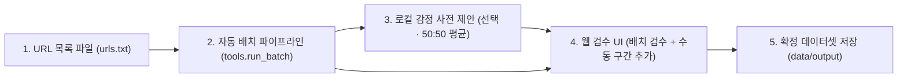

# EmoLabel 프로그램 작동 방식 및 구조 안내

이 문서는 한국어 YouTube 숏츠에서 발화 클립을 수집하고, 로컬 감정 모델의 사전 제안과 사람 검수를 거쳐 감정 라벨(`neutral`, `angry`, `sad`, `happy`) 데이터셋을 구축하는 **EmoLabel**의 작동 방식과 전체 구성을 팀원이 한눈에 파악할 수 있도록 정리한 안내서입니다.

- 기본 실행 환경: **WSL2 Ubuntu · Python 3.12 · FFmpeg · CPU** (Apple Silicon Mac 호환)
- 핵심 원칙: **수집·후보 선정·사전 제안은 자동화**하되, 모델은 참고 점수만 제시(`auto_accept: false`)하고 **최종 발화 경계·대사·감정·채택 여부는 사람이 확정**합니다.

---

## 1. 전체 작동 흐름

URL 목록 파일에 여러 YouTube 링크를 넣어두면 **자동 수집·후보 선정 → (선택) 로컬 감정 사전 제안 → 웹 검수 및 수동 구간 추가 → 확정 데이터셋 저장**까지 하나의 파이프라인으로 연결됩니다.



### 단계별 동작 상세

#### ① URL 일괄 수집 · 전처리 (`tools/run_batch.py`)
- UTF-8 텍스트 파일(예: `data/urls.txt`)에 YouTube / Shorts 링크를 한 줄에 하나씩 작성합니다(`#` 주석과 빈 줄은 자동 무시).
- 같은 영상 ID가 여러 번 들어가면 자동으로 중복을 제거합니다.
- 180초를 초과하는 영상은 CPU ASR 병목을 막기 위해 자동 제외(`excluded`)하며, 개별 URL이 실패해도 나머지 영상 처리를 계속 진행합니다.
- 각 영상마다 **영상별 SQLite 락(`lock.sqlite`)**을 잡고 아래 단계를 순서대로 실행합니다.
  1. `yt-dlp`로 원본 영상 다운로드 및 메타데이터 저장(`data/downloads/{video_id}.mp4`, `.info.json`)
  2. `FFmpeg`로 16 kHz 모노 WAV 추출(`source.wav`)
  3. `Silero VAD`로 실제 발화 구간 검출(`vad.json`)
  4. `faster-whisper`(Linux) 또는 `MLX Whisper`(Mac)로 한국어 자동 전사(`asr.json`)
- 동일 설정·동일 원본으로 배치를 다시 실행하면 이미 완료된 단계는 캐시를 재사용합니다.

#### ② 발화 후보 자동 선정 (`app/candidates.py` · 선정 v3)
- ASR 세그먼트와 VAD 발화 구간을 대조해 원본 영상당 **최대 3개**의 발화 후보를 고릅니다.
- 선정 우선순위: VAD 발화 비율 ≥ 50% 및 양 끝 여백 ≤ 1.5초 우선 → 미해결 경계 위험 없음 → 길이 3–12초 우선 → 발화 비율·여백·길이·시작 시각 순.
- ASR 경계가 발화 도중에 짧게 잘린 경우(≤ 0.5초)에는 인접 발화를 침범하지 않는 범위에서 0.08초 여백을 더해 보수적으로 경계를 보정합니다.
- 앞뒤 발화가 길게 이어지는 구간은 억지로 합치지 않고 **품질 확인 플래그**(`speech_continues_before`, `speech_continues_after`, `boundary_adjusted_check_transcript`)를 달아 검수 UI의 **품질 확인 후보** 탭으로 분리합니다.
- 선정된 후보마다 `clip.mp4`와 `audio_16k.wav`를 미리 추출(`data/workspace/{video_id}/clips/{clip_id}/`)해 검수 화면에서 즉시 재생할 수 있게 합니다.

#### ③ 로컬 감정 사전 제안 (`tools/emotion_batch.py`, 선택)
- `--export-candidates`로 완료된 후보 목록(후보 ID, 원본 ASR 대사, 원본/미디어 SHA-256 지문)을 manifest JSON으로 고정해, 팀원 간 또는 모델 간 비교 시 입력 조건이 섞이지 않게 합니다.
- `--candidates`를 실행하면 두 로컬 모델이 각각 독립 프로세스로 추론하고, 5개 범주(`neutral`, `angry`, `sad`, `happy`, 내부 `other`)의 점수를 **대사 50% + 음성 50%**로 평균냅니다.
  - 대사 모델: `LimYeri/HowRU-KoELECTRA-Emotion-Classifier`
  - 음성 모델: `emotion2vec/emotion2vec_plus_base`
- `other`가 최고점이거나 공동 최고, 모델 실패·타임아웃·점수 형식 오류가 발생하면 억지로 감정을 고르지 않고 **판단 보류**로 기록합니다.
- 감정 모델이 설치되지 않았거나 추론에 실패해도 웹 검수와 수동 라벨링은 정상 동작합니다.

#### ④ 웹 검수 UI · 수동 구간 추가 (`app/main.py`, `static/`)
- 로컬 서버(`http://127.0.0.1:8000`)에 접속해 **검수자 ID 입력 → 세션 시작 → 배치 후보 검수**로 작업합니다.
- **검수 큐**: `일반 후보` / `품질 확인 후보` / `처리 이력 · 재검수`로 나뉘어 순회합니다.
- **재생 및 경계 조정**: 원본 파형 드래그, 선택 구간 자동 정지, 원본 이어듣기, 프레임/0.05초 단위 미세 조정, 단축키(`Space` 재생/일시정지, `L` 반복, `[` `]` 시작/끝 지정, `1–4` 감정 선택)를 지원합니다.
- **점수 비교 표 및 블라인드 모드**:
  - 일반 검수에서는 5감정 × 대사/음성/평균 참고 점수 표를 보여 주며, 사람 감정 라디오는 절대 미리 선택하지 않습니다. 대사나 경계를 수정하면 기존 모델 제안은 자동으로 숨깁니다.
  - **독립 정답 작성(블라인드)** 모드에서는 모델 제안, 기존 검수 이력, ASR 초안을 모두 가립니다.
- **작업 시간 측정**: 탭 비활성화, 서버 요청 대기, 90초 이상 무입력(유휴) 시간을 제외한 **활성 검수 시간**만 기록합니다.
- **수동 구간 추가 (3.5단계)**:
  - 자동 선정에서 빠진 좋은 발화는 **＋ 새 구간 추가**를 눌러 원본 파형에서 직접 선택하고 독립된 `pending` 후보(`[직접 추가]`)로 추가할 수 있습니다.
  - 추가 모드 진입·취소·실패 시 기존 후보의 경계와 작성 중인 검수 내용은 보호되며, 새 후보 추가 시 기존 후보 초안도 세션 내에 보관됩니다.
  - 배치 `asr.json`이 이미 있으면 겹치는 구간 대사를 즉시 초안으로 채워 주고, 필요할 때 **대사 자동 전사** 버튼으로 해당 클립 WAV만 단건 Whisper 전사할 수도 있습니다.
  - 자동 후보가 0건인 영상도 상단 URL **수동 불러오기** 후 **＋ 새 구간 추가**로 검수 큐에 편입할 수 있습니다.

#### ⑤ 확정 저장 및 데이터 보호 (`app/review.py`)
- 검수자는 각 후보를 **채택(`accepted`) / 수정 후 채택(`accepted_edited`) / 보류(`hold`) / 제외(`rejected`)**로 저장합니다.
- 채택된 클립만 최종 출력 폴더(`data/output/{clip_id}/`)에 `clip.mp4`, `audio_16k.wav`, `prelabels.json`, `annotation.json`으로 원자적(트랜잭션) 저장됩니다.
- 경계를 수정하면 새 `clip_id`로 후보를 생성하고 기존 후보는 `superseded`로 전환해 중복 집계를 막습니다. 이미 채택한 클립을 추후 보류·제외로 철회하면 `data/output/`에서 제거하고 작업 공간 `quarantine/`에 격리합니다.
- 배치나 모델 추론을 다시 실행해도 사람이 확정한 `annotation.json`, 검수 장부(`reviews.json`), 직접 추가한 수동 후보는 덮어쓰지 않습니다.

---

## 2. 프로젝트 구성

### 디렉터리 구조

```text
산학/
├── README.md                          # 저장소 지도·모듈 점프 테이블·기본 검증 명령
├── AGENTS.md                          # 협업·편집·검증·비밀 보호 규칙
├── PLAN.md                            # 단계별 진행 현황·합의 기준·체크리스트·최신 인계
├── docs/
│   ├── WORKFLOW_GUIDE.md              # 본 문서 (작동 방식 및 구성 안내)
│   ├── PILOT_LOG.md                   # 파일럿 실행 및 진단·평가 이력
│   └── HANDOFF_LOG.md                 # 과거 작업 인계 이력
└── emolabel-youtube/                  # 실제 애플리케이션 구현
    ├── README.md                      # Ubuntu/Mac 설치·모델 연결·상세 실행 런북
    ├── .env.example                   # 환경 변수 및 로컬 감정 모델 설정 예시
    ├── app/                           # 백엔드 코어 및 FastAPI 서버
    ├── tools/                         # 배치 수집·감정 추론·진단·평가 CLI 도구
    ├── static/                        # 웹 검수 UI (Vanilla JS / HTML / CSS)
    └── test_*.py / test_*.mjs         # Python 단위/API 테스트 및 Node UI/재생 테스트
```

### 핵심 모듈별 역할 (`emolabel-youtube/`)

| 계층 | 파일 | 담당 역할 |
| --- | --- | --- |
| **설정·스키마** | `app/config.py`, `app/schemas.py` | 환경 변수·경로·길이 제한·감정 라벨 정의, Pydantic strict 요청 검증 |
| **수집·미디어** | `app/youtube.py`, `app/media.py`, `app/candidate_media.py` | YouTube ID 파싱·180초 상한 다운로드, FFmpeg 자르기·16 kHz WAV·파형 피크 추출, 후보 미디어 캐시 |
| **음성 분석·선정** | `app/asr.py`, `app/asr_faster.py`, `app/qc.py`, `app/gender.py`, `app/candidates.py` | 한국어 Whisper 전사(Linux/Mac 분기), Silero VAD·얼굴/화자 QC, 선정 v3 경계 보정 및 후보 순위 결정 |
| **배치·감정 추론** | `tools/run_batch.py`, `tools/emotion_batch.py`, `app/emotion.py`, `app/emotion_scores.py`, `tools/scored_emotion.py`, `tools/local_emotion.py` | URL 파일 일괄 배치 실행, 고정 manifest 생성·실행, 로컬 모델 프로세스 분리·타임아웃·R1 오류 진단·50:50 평균 결합 |
| **검수 장부·API** | `app/review.py`, `app/review_api.py`, `app/store.py`, `app/main.py` | 영상별 락 기반 검수 장부(`reviews.json`), 수동 구간 추가·단건 전사, 원자적 확정 저장·`superseded`·철회 격리, FastAPI 서버 |
| **웹 UI** | `static/index.html`, `static/app.js`, `static/review.mjs`, `static/style.css` | 검수 큐, WaveSurfer 파형·구간 자동 정지, 모델 점수 비교 표, 수동 추가/초안 보호, 유휴 제외 활성 타이머 |
| **설정·평가 CLI** | `tools/configure_emotion.py`, `tools/check_emotion_connection.py`, `tools/reproduce_boundaries.py`, `tools/evaluate_models.py`, `tools/dataset_status.py` | 감정 모델 설정 생성, 실모델 연결 확인, R0 경계 진단, R3 오프라인 모델 비교 평가, 확정 데이터셋 상태 집계 |

---

## 3. 데이터 저장 구조 (`emolabel-youtube/data/`)

작업 중간 산출물(`workspace/`)과 최종 확정 데이터셋(`output/`)을 엄격히 분리합니다. 이 폴더들은 `.gitignore`로 Git에서 제외됩니다.

```text
emolabel-youtube/data/
├── downloads/                         # 원본 mp4 · .info.json · .peaks.json
├── workspace/
│   ├── {video_id}/
│   │   ├── state.json                 # 배치 실행 상태 및 자동 선정 후보 목록
│   │   ├── source.json                # 원본 영상 메타데이터
│   │   ├── asr.json / vad.json        # 원본 전사 및 VAD 발화 구간 캐시
│   │   ├── reviews.json               # 사람 검수 이력 + [직접 추가] 수동 후보 영속 장부
│   │   ├── selection-history/         # 선정 버전 변경 시 이전 state.json 보관
│   │   ├── quarantine/                # 채택 후 보류/제외로 철회된 출력 격리
│   │   └── clips/{clip_id}/           # 후보 재생용 clip.mp4 · audio_16k.wav · emotion-latest.json
│   ├── pilot-v3.json                  # 고정 후보 manifest (모델 비교용)
│   └── emotion-runs/{run_id}/         # 실행별·후보별 모델 추론 상세 기록
└── output/
    └── {clip_id}/                     # 사람이 채택한 최종 클립만 저장
        ├── clip.mp4                   # 발화 구간 영상
        ├── audio_16k.wav              # 16 kHz 모노 WAV 음성
        ├── prelabels.json             # 기계 초안 (ASR 등)
        └── annotation.json            # 사람 확정 라벨·검수 이력·출처(automatic/manual)
```

---

## 4. 팀원용 빠른 실행 순서

환경 설치(FFmpeg, `uv`, 선택적 로컬 감정 모델 준비)는 [emolabel-youtube/README.md](../emolabel-youtube/README.md)를 먼저 참고하세요.

### Step 1. URL 목록 파일 작성
`emolabel-youtube/data/urls.txt`를 만들고 수집할 한국어 Shorts URL을 한 줄에 하나씩 적습니다.

```text
# 한국어 발화 숏츠 목록
https://www.youtube.com/shorts/DGwuCn-EDfQ
https://www.youtube.com/shorts/mKwJDo0YTkM
https://www.youtube.com/shorts/6yrnO_6Hl0I
```

### Step 2. 자동 수집 · 후보 추출 배치 실행
```bash
cd emolabel-youtube
uv run python -m tools.run_batch --urls data/urls.txt --video-workers 1
```
(`--urls`를 생략하면 기본 파일럿 목록 `pilot_v1` 3개 영상을 처리합니다.)

### Step 3. 로컬 감정 사전 제안 실행 (선택 · 모델 설치 환경)
```bash
uv run python -m tools.run_batch --export-candidates data/workspace/pilot-v3.json
uv run python -m tools.run_batch --candidates data/workspace/pilot-v3.json --run-tag howru-emotion2vec-mean-v1
```

### Step 4. 웹 검수 화면 실행 및 라벨링
```bash
uv run uvicorn app.main:app --host 127.0.0.1 --port 8000
```
브라우저에서 `http://127.0.0.1:8000` 접속 → **검수자 ID 입력 → 세션 시작 → 배치 후보 검수**로 후보를 검수하고, 필요한 발화는 **＋ 새 구간 추가**로 직접 추가한 뒤 채택 저장합니다.

### Step 5. 확정 데이터셋 상태 확인
```bash
uv run python tools/dataset_status.py --root data/output
```
